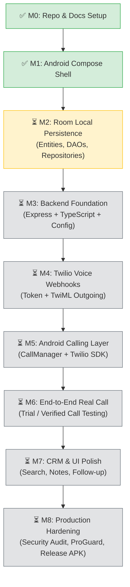

# 🚀 CallBridge — Master Improvement & Execution Plan

**Version:** 2.0 (Post M0-M1 Baseline)  
**Status:** In Active Execution  
**Current Progress:** Milestone M0 & M1 Completed ✅  
**Target:** Production-Grade Personal Calling App (Bangladesh to US PSTN)  

---

## 🎯 Executive Summary & Objectives

CallBridge is an authenticated Android client and secure Node.js backend providing outbound voice calling to permitted United States destinations (+1) via Twilio Voice.

This document details:
1. **Critical architectural and engineering improvements** identified from the initial design review.
2. **Current milestone progress and verification status**.
3. **Phase-by-phase execution roadmap** with strict definition-of-done criteria for each step.

---

## 💡 Key Architectural & Engineering Improvements

### 1. Robust Audio Routing & Foreground Calling Service
* **Issue in naive VoIP apps:** When the user switches apps or turns off the screen, Android aggressively suspends background activities, dropping VoIP audio or disconnecting calls.
* **Improvement:** In Milestone M5, introduce an Android `ForegroundService` with an ongoing notification (`type="microphone"` or `type="phoneCall"`) or investigate Android `Telecom` integration to ensure calls stay stable when the user locks their screen or switches apps.
* **Audio Routing:** Use modern Android `AudioManager` and audio device callback APIs to handle Earpiece, Speakerphone, and Bluetooth Headsets gracefully.

### 2. Idempotent History & Callback Reconciliation
* **Issue:** Twilio status callbacks deliver at-least-once (retries happen), and the Android SDK also emits terminal call events. Without idempotency, duplicate history entries appear.
* **Improvement:** Ensure `call_history` records use a unique deterministic key (`providerCallSid` or UUID generated at call initiation) so duplicate updates gracefully reconcile without duplication.

### 3. Dual-Environment Backend Deployment Architecture
* **Local Development:** Support local testing using ngrok/localtunnel for Twilio webhooks, pairing with a lightweight test suite that mocks Twilio responses.
* **Production Deployment:** Containerized Dockerfile or lightweight Node.js deployment ready for platforms like Railway, Render, Fly.io, or VPS.

### 4. Zero-Secret Architecture & Strict Security Envelope
* Token endpoints require authentication.
* TwiML Outbound Webhooks strictly verify Twilio cryptographic signatures (`X-Twilio-Signature`) against the external public URL.
* All logs scrub destination numbers, credentials, and tokens.

---

## 🗺️ Phase-by-Phase Roadmap & Milestones

---

## 📋 Milestone Breakdown & Action Items

### ✅ Milestone M0: Repository Setup & Specification Baseline
- [x] Consolidate specifications into `docs/` and `.agents/`.
- [x] Configure `.gitignore` to prevent any secret, build artifact, or environment leak.
- [x] Create safe `backend/.env.example`.
- [x] Initialize Git repository with initial commit.

### ✅ Milestone M1: Android Compose UI Shell
- [x] Setup Kotlin, AGP 8.7, Compose BOM, Room dependencies in Version Catalog.
- [x] Establish Material 3 Theme (Light & Dark color palettes, Typography).
- [x] Build Navigation graph (`AppNavigation.kt`) with Bottom Navigation Bar.
- [x] Implement UI screens: Dashboard, Dial Pad, Active Call, Contacts, Contact Details, Add/Edit Contact, Call History, Call Details, Settings.
- [x] Unit test setup for phone validation.

### ⏳ Milestone M2: Local Data Persistence (Room Database)
* **Goal:** Make contacts and call history persist across app restarts without cloud dependency.
* **Deliverables:**
  - `ContactEntity` & `ContactDao` (CRUD, search, indexes on E.164 and name).
  - `CallHistoryEntity` & `CallHistoryDao` (idempotent insert, order by timestamp desc).
  - `CallBridgeDatabase` with migration support.
  - Repositories connecting Room DAOs to ViewModel state.
  - Unit tests for DAOs and repository logic.

### ⏳ Milestone M3: Backend Foundation (Node.js + TypeScript)
* **Goal:** A lightweight, secure API server handling health checks, request validation, and configuration loading.
* **Deliverables:**
  - `package.json`, `tsconfig.json` with strict TypeScript.
  - Express server setup with CORS, helmet, and body-parsers.
  - `GET /api/v1/health` with service status (no secrets).
  - Configuration loader with Zod validation.
  - Structured logger with redaction.
  - Rate limiting middleware.

### ⏳ Milestone M4: Twilio Server Service & Webhooks
* **Goal:** Secure Access Token generation and TwiML voice routing.
* **Deliverables:**
  - `POST /api/v1/voice/token`: Generates short-lived Twilio Access Token with VoiceGrant and identity.
  - `POST /api/v1/voice/outgoing`: Twilio webhook returning valid TwiML `<Dial>` to US numbers.
  - `POST /api/v1/voice/status`: Signature-verified status callback handler.
  - Signature verification middleware using `twilio.validateRequest`.
  - Allowed destination country policy (+1) server-side enforcement.

### ⏳ Milestone M5: Android Calling Layer & SDK Integration
* **Goal:** Connect the Android app to Twilio Voice Android SDK behind a clean abstraction.
* **Deliverables:**
  - Typed Retrofit API client to fetch Access Token from backend.
  - `CallManager` interface and implementation wrapping Twilio Voice SDK.
  - Reactive `StateFlow<CallUiState>`: Idle, RequestingPermission, FetchingToken, Connecting, Ringing, Connected, Ending, Ended, Failed.
  - Mute and Speaker routing controls.
  - Single-active-call guard.

### ⏳ Milestone M6: Real Call Testing & Verification
* **Goal:** Verify end-to-end outbound calling to an authorized US number.
* **Deliverables:**
  - Configure Twilio Console with TwiML App URL (via tunnel or deployed backend).
  - Test outbound call from Android device/emulator.
  - Verify connected timer begins strictly on confirmed connection.
  - Verify terminal event saves call history record once.

### ⏳ Milestone M7: Personal CRM Polish
* **Goal:** Seamless contact linking, follow-up notes, and call-back workflows.
* **Deliverables:**
  - Link incoming/outgoing calls to existing contacts by E.164 match.
  - Add/edit contact notes and follow-up dates.
  - Search contacts by name, company, or number.

### ⏳ Milestone M8: Production Hardening & Release Preparation
* **Goal:** Release-ready personal APK.
* **Deliverables:**
  - ProGuard/R8 rules optimization.
  - Full automated lint and unit test suite verification.
  - Secret audit across repository, logs, and generated artifacts.
  - Release APK build instructions.

---

## 🔒 Security & Compliance Checklist

- [ ] Zero credentials in APK or repository.
- [ ] Backend token endpoint rate-limited and session-authenticated.
- [ ] Twilio webhook signatures strictly verified.
- [ ] Destination policy server-side enforced (+1 only).
- [ ] Phone numbers redacted in backend logs.
- [ ] Room database local-only by default.
