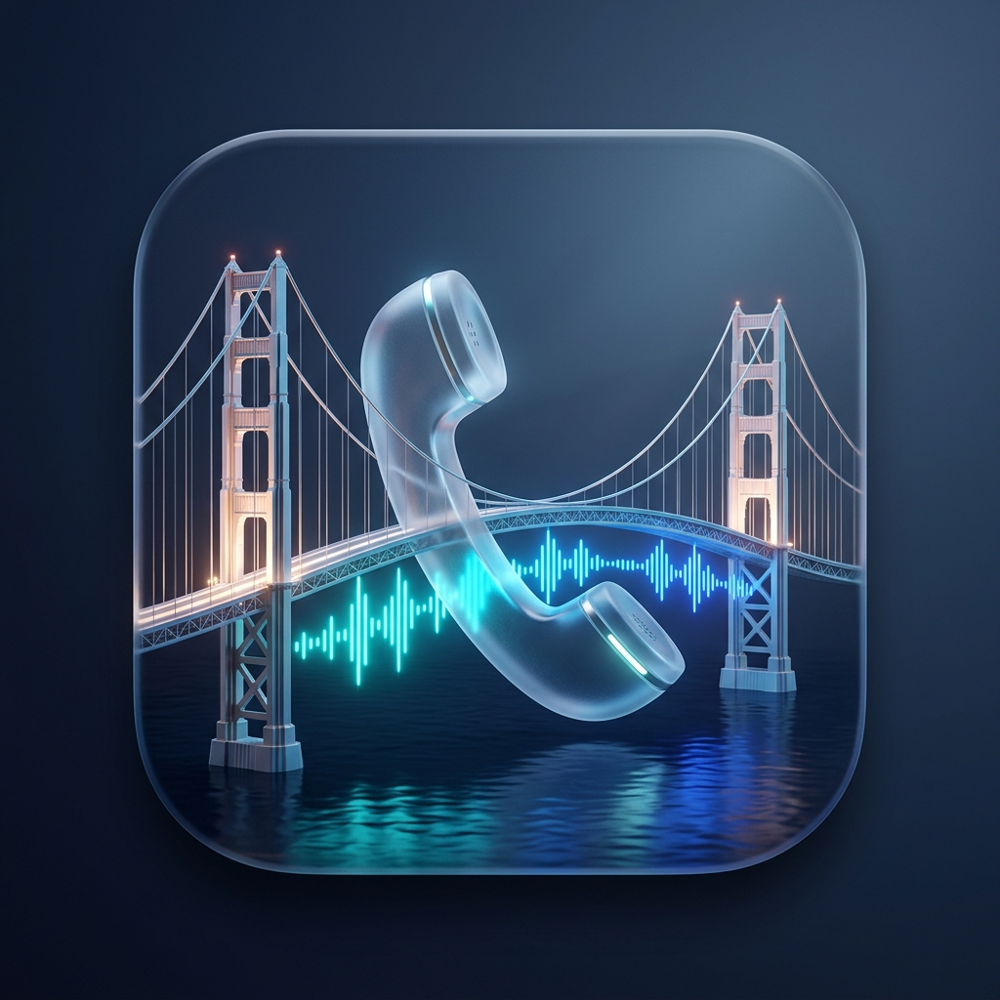
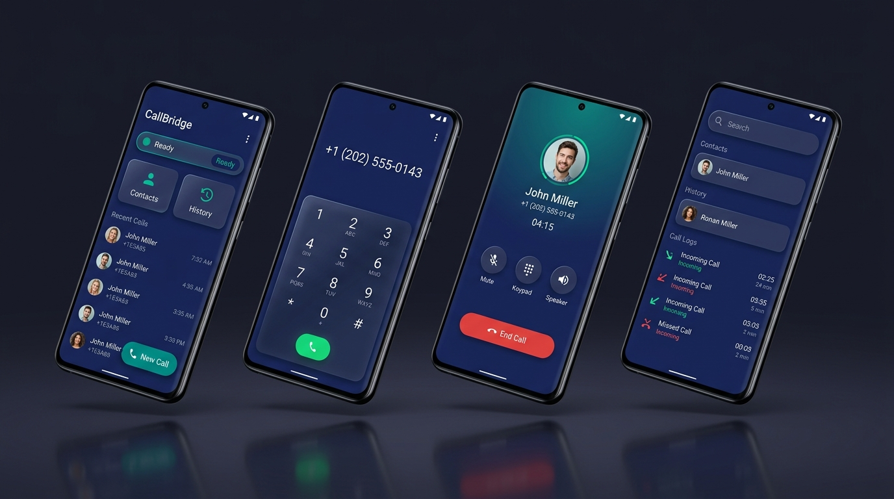
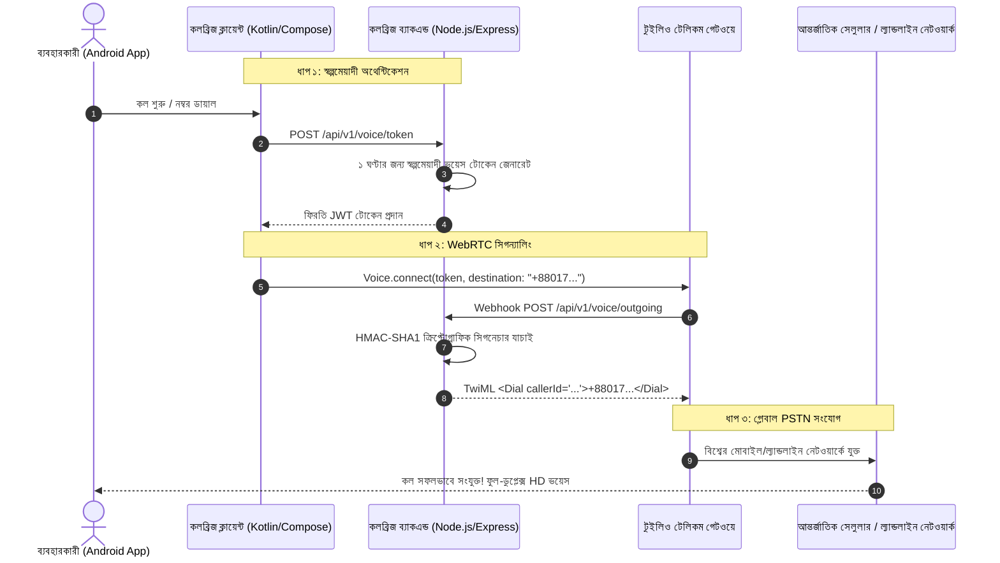

# 🌉 CallBridge (কলব্রিজ)

<div align="center">



### প্রাইভেসিকেন্দ্রিক আন্তর্জাতিক VoIP টেলিফোনি ও ২-ওয়ে SMS মেসেজিং স্যুট

[-007AFF?style=for-the-badge&logo=android&logoColor=white)](https://github.com/0xmcr/CallBridge/releases)
[](https://developer.android.com/)
[](https://developer.android.com/jetpack/compose)
[](https://kotlinlang.org/)
[](https://nodejs.org/)
[](https://www.typescriptlang.org/)
[](https://www.twilio.com/)
[](LICENSE)

<br/>

**[🇺🇸 English](README.md)** • **[🇧🇩 বাংলা সংস্করণ](README.bn.md)** • **[🤝 কন্ট্রিবিউশন নির্দেশিকা](CONTRIBUTING.md)** • **[🔒 সিকিউরিটি পলিসি](SECURITY.md)** • **[📜 লাইসেন্স](LICENSE)**

</div>

---

## 📱 অ্যাপ্লিকেশন শোকেস

<div align="center">

</div>

---

## 📖 CallBridge কী?

**CallBridge** হলো একটি আধুনিক, প্রাইভেসিকেন্দ্রিক এন্টারপ্রাইজ অ্যান্ড্রয়েড টেলিকমিউনিকেশন অ্যাপ্লিকেশন এবং ক্লাউড গেটওয়ে, যা যেকোনো অ্যান্ড্রয়েড স্মার্টফোন থেকে বিশ্বব্যাপী ১০০টিরও বেশি দেশে অতি সুলভ মূল্যে ক্রিস্টাল-ক্লিয়ার VoIP-থেকে-PSTN ফোন কল ও দ্বিমুখী SMS আদান-প্রদান করতে সক্ষম।

সাধারণ আন্তর্জাতিক রোমিং বা সেলুলার কলিংয়ে যেখানে প্রতি মিনিটে প্রায় ২০ থেকে ১০০ টাকা পর্যন্ত খরচ হয়, সেখানে CallBridge ক্লাউড টেলিকম পাইপলাইনের মাধ্যমে পাইকারি খরচে (যেমন আমেরিকায় প্রতি মিনিটে মাত্র ~\$0.014 বা ১.৫০ টাকা) কল ও মেসেজ নিশ্চিত করে।

---

## ✨ প্রধান বৈশিষ্ঠ্যসমূহ (Key Features)

### ১. 📞 গ্লোবাল VoIP ডায়ালিং ও অরিজিনাল DTMF সাউন্ড
- **১০০+ দেশের ডিরেক্টরি:** মার্কিন যুক্তরাষ্ট্র (`+1`), বাংলাদেশ (`+880`), যুক্তরাজ্য (`+44`), ভারত (`+91`), সংযুক্ত আরব আমিরাত (`+971`), সৌদি আরব (`+966`) সহ বিশ্বের ১০০+ দেশের সাপোর্ট।
- **ইনস্ট্যান্ট কান্ট্রি সার্চ:** ডায়ালপ্যাড থেকেই সেকেন্ডের মধ্যে দেশের নাম বা কান্ট্রি কোড লিখে সার্চ করার অপশন।
- **আসল টেলিফোন ডায়াল টোন (DTMF):** `ToneGenerator.STREAM_DTMF` দিয়ে তৈরি বাস্তব টেলিফোন স্পর্শ অনুভূতি ও ভাইব্রেশন ফিডব্যাক।
- **ইন-কল কন্ট্রোল:** লাইভ কল ডিউরেশন টাইমার, অডিও ওয়েভ অ্যানিমেশন, মিউট, স্পিকারফোন ও ইনস্ট্যান্ট কল নোটস।

### ২. 💬 CallBridge দ্বিমুখী SMS মেসেজিং হাব
- **আধুনিক চ্যাট ইন্টারফেস:** সিগনেচার ব্লু বাবল, রিসিট স্ট্যাটাস এবং প্রফেশনাল চ্যাট থ্রেড।
- **রিয়েলটাইম ১৬০-ক্যারেক্টার GSM সেগমেন্ট কাউন্টার:** মেসেজ লেখার সাথে সাথেই টেলিকম বিলিং সেগমেন্ট ও ক্যারেক্টার হিসাব প্রদর্শন করে, যাতে অতিরিক্ত বিল কাটা প্রতিরোধ করা যায়।
- **কুইক বিজনেস টেমপ্লেটস:** এক ক্লিকেই রেডিমেড মেসেজ পাঠানোর সুবিধা।
- **কন্টাক্টস ও হিস্ট্রির সাথে একীভূত:** যেকোনো কন্টাক্ট বা মিসড কল লগ থেকে সরাসরি ১-ট্যাপে এসএমএস পাঠানো।

### ৩. ⚡ লাইভ অ্যাকাউন্ট টেলিমেট্রি
- **রিয়েলটাইম ব্যালেন্স চেক:** অ্যাপ থেকেই সরাসরি Twilio অ্যাকাউন্টের ডলার ব্যালেন্স পর্যবেক্ষণ ও রিফ্রেশ।
- **কলার আইডি পরিবর্তন:** নিজের একাধিক ভার্চুয়াল নম্বরের মধ্যে সহজে সুইচ করার সুবিধা।

### ৪. 🛡️ জিরো-ট্রাস্ট সিকিউরিটি ও লোকাল প্রাইভেসি
- **ক্লায়েন্ট অ্যাপে কোনো সিক্রেট নেই:** অ্যান্ড্রয়েড APK-তে কোনো পাসওয়ার্ড বা এপিআই কী থাকে না; ফলে APK ডিকম্পাইল করলেও কোনো ডাটা ফাঁস হওয়া অসম্ভব।
- **১০০% অন-ডিভাইস ডাটাবেজ:** সমস্ত কন্টাক্ট, কল হিস্ট্রি এবং এসএমএস মেসেজ ব্যবহারকারীর নিজস্ব ডিভাইসের লোকাল SQLite Room ডাটাবেজে এনক্রিপ্ট থাকে। কোনো সার্ভারে ব্যক্তিগত তথ্য সংরক্ষিত হয় না।

---

## 🏛️ সিস্টেম আর্কিটেকচার



---

## 🛠️ প্রোডাকশন সেটআপ গাইড (Firebase FCM V1 + Twilio + Railway)

পাবলিক রিপো ব্যবহারকারীরা নিজের প্রজেক্ট চালাতে নিচের ধাপগুলো অনুসরণ করতে পারেন:

1. **ব্যাকএন্ড এনভায়রনমেন্ট (`backend/.env`):**
   ```bash
   cd backend
   cp .env.example .env
   npm install && npm run build && npm start
   ```
2. **Firebase FCM V1 (ইনকামিং কল রিং হওয়ার জন্য):**
   - [Firebase Console](https://console.firebase.google.com)-এ নতুন প্রজেক্ট খুলে `com.callbridge.personal` প্যাকেজ নামে Android App যুক্ত করুন।
   - `google-services.json` ডাউনলোড করে `android/app/google-services.json` পথে রাখুন।
   - **Project Settings → Service accounts → Generate new private key** থেকে Service Account JSON ডাউনলোড করুন:
     - **লোকাল ডেভ:** `backend/firebase-adminsdk.json` নামে রাখুন (`FIREBASE_SERVICE_ACCOUNT_PATH=./firebase-adminsdk.json`)।
     - **ক্লাউড (Railway/Render):** পুরো JSON কনটেন্ট `FIREBASE_SERVICE_ACCOUNT_JSON` ভ্যারিয়েবলে দিন।
3. **Twilio Webhook কনফিগারেশন:**
   - TwiML App Voice URL: `https://<your-backend>/api/v1/voice/outgoing`
   - Purchased Number Voice URL: `https://<your-backend>/api/v1/voice/incoming`
   - Purchased Number SMS URL: `https://<your-backend>/api/v1/sms/incoming`
4. **Android APK বিল্ড:**
   ```bash
   cd android && ./gradlew assembleDebug
   ```
   অথবা রুট ডিরেক্টরি থেকে **`CallBridge-v1.1.1-debug.apk`** সরাসরি ইনস্টল করুন।

---

## 👨‍💻 আর্কিটেক্ট ও স্রষ্টা (Author & Architect)

**CallBridge** সম্পূর্ণভাবে ডিজাইন, আর্কিটেক্ট এবং তৈরি করেছেন:

- **মহেশ্বর চন্দ্র রায় ([@0xmcr](https://github.com/0xmcr))**
- **গিটহাব প্রোফাইল:** [https://github.com/0xmcr](https://github.com/0xmcr)
- **অফিশিয়াল ইমেইল:** [maheshwarchandra.dev@gmail.com](mailto:maheshwarchandra.dev@gmail.com)

---

## 📜 লাইসেন্স

এই প্রজেক্টটি **CallBridge Source-Available & Non-Commercial License**-এর অধীনে উন্মুক্ত — বাণিজ্যিক পুনর্বিক্রয়, সাবস্ক্রিপশন ব্যবসা বা পেইড প্যাকেজিং সম্পূর্ণ নিষিদ্ধ। বিস্তারিত জানার জন্য [LICENSE](LICENSE) ফাইলটি দেখুন।  
কপিরাইট © ২০২৬ **মহেশ্বর চন্দ্র রায় ([0xmcr](https://github.com/0xmcr))**।
