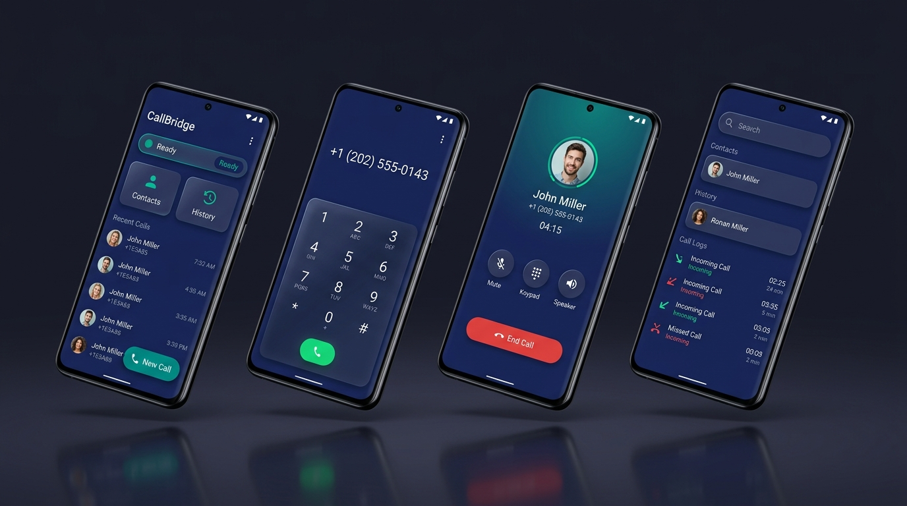
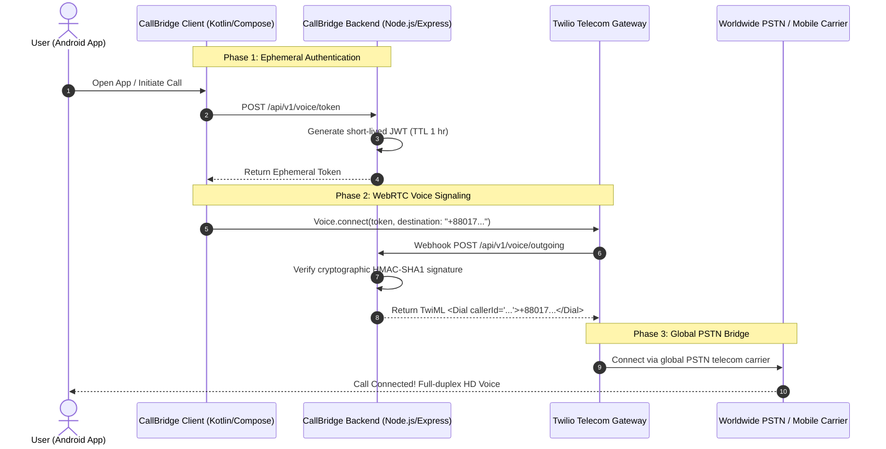

# 🌉 CallBridge

<div align="center">


### Privacy-First Global VoIP Telephony & 2-Way SMS Messaging Suite

[-007AFF?style=for-the-badge&logo=android&logoColor=white)](https://github.com/0xmcr/CallBridge/releases)
[](https://developer.android.com/)
[](https://developer.android.com/jetpack/compose)
[](https://kotlinlang.org/)
[](https://nodejs.org/)
[](https://www.typescriptlang.org/)
[](https://www.twilio.com/)
[](LICENSE)

<br/>

**[🇺🇸 English](README.md)** • **[🇧🇩 বাংলা সংস্করণ](README.bn.md)** • **[🤝 Contributing Guidelines](CONTRIBUTING.md)** • **[🔒 Security Policy](SECURITY.md)** • **[📜 License](LICENSE)**

</div>

---

## 📱 Application Showcase

<div align="center">

</div>

---

## 📖 What is CallBridge?

**CallBridge** is an enterprise-grade, privacy-first telecommunications application that transforms any Android smartphone into a high-fidelity international calling and SMS communication hub. Powered by **Twilio Programmable Voice & Messaging**, CallBridge bridges low-cost VoIP over internet data directly to worldwide carrier telephone lines (PSTN) across **100+ countries**.

Traditional international cellular roaming or direct carrier dialing incurs steep tariffs (~\$0.30 to \$1.50/min) with unpredictable call quality. CallBridge routes voice and SMS through programmable cloud infrastructure at raw wholesale rates (~\$0.014/min for US calls), ensuring crystal-clear audio with **zero provider lock-in**.

---

## ✨ Flagship Capabilities

### 1. 📞 Global VoIP Calling & Authentic DTMF Dialer
- **Worldwide Reach:** Outbound calling across 100+ sovereign countries with ITU-T E.164 compliance (`+1` US/Canada, `+880` Bangladesh, `+44` UK, `+91` India, `+971` UAE, `+966` Saudi Arabia, and more).
- **Interactive Country Picker:** Instant alphabetical and code search covering 100+ official Twilio-supported territories with vibrant Unicode flag emojis.
- **Realistic Telephonic Interaction:** Built-in `ToneGenerator.STREAM_DTMF` emits authentic telephone dial tones (0-9, *, #) with synchronized tactile haptic feedback.
- **In-Call Controls:** Active duration timer, in-call audio pulse animation, Mute, Speakerphone, and in-call scratchpad notes.

### 2. 💬 CallBridge 2-Way SMS Messaging Suite
- **Apple iMessage Aesthetic:** Pure ceramic light and OLED dark bubbles with vibrant blue gradients (`#007AFF`), centered date badges, and "• Delivered" delivery receipt tags.
- **Real-Time 160-Character GSM Billing Counter:** Protects users from unexpected multi-segment carrier fees by tracking GSM 7-bit (160 chars) and Unicode UCS-2 (70 chars) thresholds live as you type.
- **Quick Business Templates:** One-tap quick response templates (*"Please call me back"*, *"In a meeting"*, etc.) for instant messaging without typing.
- **Deep CRM Integration:** Send SMS directly with 1 tap from Contacts profiles or Call History log details.

### 3. ⚡ Live Twilio Account Telemetry
- **Instant Balance Checking:** View live Twilio dollar balance on the Dashboard and in Settings without logging into the Twilio web console.
- **Caller ID Management:** Easily switch between purchased virtual phone numbers with verified caller identification badges.

### 4. 🛡️ Absolute Zero-Trust Privacy & Architecture
- **Zero Client Secrets:** The Android APK contains **zero** permanent Twilio credentials or API secrets.
- **Ephemeral Access Tokens:** The mobile client obtains time-limited JWT tokens with a 1-hour TTL strictly held in volatile memory.
- **100% On-Device CRM:** All contacts, call history logs, and SMS conversations reside strictly in a local SQLite Room database on your device. Zero cloud sync leakage.

---

## 🏛️ System Architecture



---

## 📂 Project Directory Structure

```text
CallBridge/
├── android/                         # Native Android Application (API 35)
│   ├── app/
│   │   ├── src/main/java/com/callbridge/personal/
│   │   │   ├── calling/             # CallManager, WebRTC & Twilio Voice SDK wrapper
│   │   │   ├── data/
│   │   │   │   ├── local/           # Room Database, DAOs, Entities (Contacts, Calls, SMS)
│   │   │   │   ├── remote/          # Retrofit REST APIs (Tokens, SMS, Telemetry)
│   │   │   │   └── repository/      # Clean Architecture Repositories
│   │   │   ├── ui/
│   │   │   │   ├── activecall/      # In-call screen, DTMF keypad & audio waves
│   │   │   │   ├── contacts/        # Personal CRM & 1-tap call/SMS actions
│   │   │   │   ├── dashboard/       # Balance widget, Quick Stats & Recent Calls
│   │   │   │   ├── dialpad/         # 100+ country dialer with DTMF audio feedback
│   │   │   │   ├── history/         # Call logs, durations, and recall buttons
│   │   │   │   ├── messages/        # CallBridge SMS hub & thread conversations
│   │   │   │   ├── onboarding/      # Splash branding & privacy permissions walkthrough
│   │   │   │   ├── settings/        # Live telemetry, caller ID switch & themes
│   │   │   │   ├── theme/           # Midnight Obsidian dark & Pure Ceramic light themes
│   │   │   │   └── util/            # GSM SMS segment counter & format utilities
│   │   └── build.gradle.kts         # Versioning, KSP, and dependencies
├── backend/                         # Node.js / Express / TypeScript Telecom Gateway
│   ├── src/
│   │   ├── config/                  # Environment variable validation (Zod)
│   │   ├── routes/                  # Voice, SMS, Account Telemetry & Health routes
│   │   ├── services/                # Twilio Voice Token, TwiML Dial, & SMS dispatch
│   │   └── app.ts                   # Express app with cryptographic webhook verification
│   ├── render.yaml                  # 1-Click Deploy blueprint for Render
│   ├── railway.json                 # 1-Click Deploy template for Railway
│   └── Dockerfile                   # Production containerization
├── docs/                            # Architecture specifications & diagrams
├── README.bn.md                     # বাংলা ডকুমেন্টেশন (Bengali Documentation)
├── SECURITY.md                      # Vulnerability reporting and security guarantees
├── CONTRIBUTING.md                  # Contributor workflow and standards
└── LICENSE                          # MIT License (© 2026 Maheshwar Chandra Roy)
```

---

## 🚀 Quick Start Guide

### 1. Clone Repository
```bash
git clone https://github.com/0xmcr/CallBridge.git
cd CallBridge
```

### 2. Run Backend Gateway
Run locally or deploy via Docker / Cloud:
```bash
cd backend
cp .env.example .env
npm install
npm run build
npm start
```

### 3. Firebase FCM V1 Setup (Incoming Call Push)
> 📘 **Full Step-by-Step Public Guide:** See **[guides/SETUP_GUIDE.md](guides/SETUP_GUIDE.md)** for exact click-by-click screenshots/URLs covering **Firebase FCM V1**, **Railway Hosting**, **Twilio Setup**, and **Android APK Build**.

1. Create a project in [Firebase Console](https://console.firebase.google.com) and register an Android app with package name `com.callbridge.personal`.
2. Download `google-services.json` and place it at:
   ```text
   android/app/google-services.json
   ```
3. In Firebase Console → **Project Settings → Service accounts → Generate new private key**, download the Service Account JSON:
   - **Local dev:** Save as `backend/firebase-adminsdk.json` (git-ignored) and set `FIREBASE_SERVICE_ACCOUNT_PATH=./firebase-adminsdk.json` in `backend/.env`.
   - **Cloud (Railway/Render):** Paste the single-line JSON into the `FIREBASE_SERVICE_ACCOUNT_JSON` environment variable.
4. In **Twilio Console → Voice → Push Credentials**, create an **FCM** credential using your Firebase Service Account JSON to get `TWILIO_PUSH_CREDENTIAL_SID`, and point your Twilio number's Voice & SMS webhooks to:
   - Voice Incoming: `https://<your-backend-domain>/api/v1/voice/incoming`
   - Voice Outgoing (TwiML App): `https://<your-backend-domain>/api/v1/voice/outgoing`
   - SMS Incoming: `https://<your-backend-domain>/api/v1/sms/incoming`

### 4. Build & Install Android APK
```bash
cd android
./gradlew assembleDebug
```
Pre-compiled APKs are also available in the repository root:
- **`CallBridge-v1.1.1-debug.apk`** (Latest production build with FCM V1 + 8-language UI)

---

## 🔒 Security & Vulnerability Reporting

CallBridge operates under strict zero-trust standards. If you discover a vulnerability or security concern, please review our **[Security Policy](SECURITY.md)** and report it directly to:  
📧 **[maheshwarchandra.dev@gmail.com](mailto:maheshwarchandra.dev@gmail.com)**

---

## 👨‍💻 Author & Principal Architect

**CallBridge** is designed, architected, and maintained by:

- **Maheshwar Chandra Roy ([@0xmcr](https://github.com/0xmcr))**
- **Website & Profile:** [https://github.com/0xmcr](https://github.com/0xmcr)
- **Email:** [maheshwarchandra.dev@gmail.com](mailto:maheshwarchandra.dev@gmail.com)

---

## 📜 License

This project is licensed under the **CallBridge Source-Available & Non-Commercial License** — commercial resale, repackaging, or paid monetization is strictly prohibited without written authorization. See the [LICENSE](LICENSE) file for complete terms.  
Copyright © 2026 **Maheshwar Chandra Roy ([0xmcr](https://github.com/0xmcr))**.
