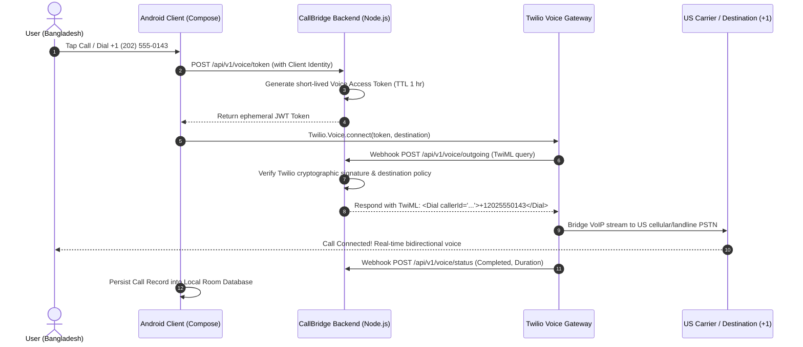

# 🌉 CallBridge

<div align="center">


### Low-Latency VoIP-to-PSTN Calling from Bangladesh to the United States

[](https://developer.android.com/)
[](https://developer.android.com/jetpack/compose)
[](https://kotlinlang.org/)
[](https://nodejs.org/)
[](https://www.typescriptlang.org/)
[](https://www.twilio.com/docs/voice)
[](LICENSE)

</div>

---

## 📱 App Showcase

<div align="center">

</div>

---

## 📖 Overview

**CallBridge** is a modern, privacy-focused Android calling application and lightweight backend bridge enabling crisp, low-latency, VoIP-to-PSTN telephone calls from Bangladesh to United States (`+1`) mobile and landline numbers via Twilio Voice.

### Why CallBridge?
Traditional international cellular roaming and international direct dialing (IDD) from Bangladesh to the United States incur high per-minute tariffs (~15-30 BDT/min) with unpredictable audio quality. CallBridge leverages programmable IP telephony to bridge calls over internet data at standard Twilio rates (~$0.014/min) directly to regular US telephone carriers.

---

## ✨ Key Features

- 📞 **Outbound Calling to US Numbers (`+1`):** Dial any US mobile, business, or landline phone number directly from the native dialpad.
- 🎨 **Modern Material 3 Design System:** Built with Jetpack Compose featuring dynamic dark/light theming, responsive typography, and tactile keypads.
- 📇 **Personal On-Device CRM:** Search, create, edit, and organize US contacts with real-time E.164 normalization and full notes support.
- 📜 **Full Call History & Duration Tracking:** Detailed call outcome logs, duration counters, timestamps, and one-tap call-back.
- ⏱️ **Active Call Experience:** Live duration timer ticking strictly upon PSTN connection, in-call mute, speakerphone routing, and clean disconnects.
- 🔒 **Zero Permanent Client Secrets:** Android APK contains **zero** Twilio credentials. All credentials reside strictly on the backend.
- 🛡️ **100% On-Device Privacy:** All contacts and call history are stored in a local SQLite Room database on your device. Zero cloud sync leakage.

---

## 🏛️ System Architecture & Call Flow



---

## 📁 Repository Structure

```
CallBridge/
├── android/                        # Android Client Application
│   ├── app/
│   │   ├── src/main/java/com/callbridge/personal/
│   │   │   ├── calling/            # Twilio SDK CallManager & AudioDeviceManager
│   │   │   ├── data/               # Room Database, DAOs, Repositories, DTOs
│   │   │   ├── navigation/         # Compose AppNavigation Host & Routes
│   │   │   ├── ui/                 # Material 3 Screens (DialPad, ActiveCall, CRM)
│   │   │   └── MainActivity.kt     # ComponentActivity Entry Point
│   │   ├── src/test/               # Unit Test Suites (FormatUtils, CRM, Calling)
│   │   ├── build.gradle.kts        # App Module Build & Dependencies
│   │   └── proguard-rules.pro      # ProGuard/R8 Rules for Twilio & Room
│   ├── gradle/wrapper/             # Gradle 8.9 Wrapper Jar & Properties
│   ├── build.gradle.kts            # Project Build Configuration
│   └── gradlew                     # Gradle Executable Script
│
├── backend/                        # Node.js + TypeScript Service
│   ├── src/
│   │   ├── config/                 # Zod Environment Validation
│   │   ├── logging/                # Redacting Logger (masks phone numbers)
│   │   ├── middleware/             # Webhook Cryptographic Signature Verification
│   │   ├── routes/                 # Voice & Health Endpoints
│   │   ├── services/               # Twilio Voice Token & TwiML Generator
│   │   └── server.ts               # Express Server Bootstrap
│   ├── test/                       # Health, Voice, and E2E Simulation Tests
│   ├── .env.example                # Example Environment Variables
│   ├── package.json                # Dependencies & Build Scripts
│   └── tsconfig.json               # Modern Node16 TypeScript Config
│
├── assets/                         # Visual Assets & Branding
│   ├── callbridge_logo_perfected.png # Master 3D Calling Bridge Logo (1024x1024)
│   ├── callbridge_app_showcase.png  # 4-Device Production UI Showcase Banner
│   └── ...                         # App launcher mipmaps & vector graphics
│
├── docs/                           # Architecture & Engineering Specifications
│   ├── ARCHITECTURE.md             # High-level System Topology
│   ├── CALL_FLOW_SPEC.md           # VoIP-to-PSTN Call Flow Spec
│   ├── DATA_MODEL_SPEC.md          # Room Database Entities & Schema
│   ├── END_TO_END_CALLING_GUIDE.md # Live Calling Operator Setup Guide
│   └── ...                         # Product & Technical Requirement Documents
│
├── .gitignore                      # Git Ignore Rules
├── LICENSE                         # MIT License
├── README.md                       # Master Documentation
└── SECURITY.md                     # Security Architecture & Vulnerability Reporting
```

---

## 🚀 Getting Started

### Prerequisites
- **Android Studio** (Koala / Ladybug or newer) with JDK 21
- **Node.js** v20+ or v22+
- A **Twilio Account** with a purchased US phone number (`+1`)

---

### Step 1: Start the Backend Service

```bash
# 1. Navigate to backend directory
cd backend

# 2. Install dependencies
npm install

# 3. Create .env configuration
cp .env.example .env

# 4. Fill in your Twilio credentials in .env:
# TWILIO_ACCOUNT_SID=...
# TWILIO_API_KEY_SID=...
# TWILIO_API_KEY_SECRET=...
# TWILIO_TWIML_APP_SID=...
# TWILIO_AUTH_TOKEN=...
# TWILIO_PHONE_NUMBER=+1XXXXXXXXXX

# 5. Build and launch server
npm run build
npm start
```
*The backend service will boot on `http://localhost:3000`.*

---

### Step 2: Open and Run Android App

1. Open **Android Studio**.
2. Select **File > Open...** and choose the `android/` directory.
3. Allow Gradle to sync dependencies.
4. Select an Android Emulator or connected physical device.
5. Click **Run 'app' ▶ (Shift + F10)**.

---

## 🗺️ Engineering Roadmap

- [x] **Phase 1: Outbound Calling MVP (Milestones M0 - M8 Completed)**
  - Native Compose UI Shell & Material 3 Dark/Light themes
  - 3D Calling Bridge branding & adaptive launcher icons
  - Room local database persistence (Contacts & Call History)
  - Node.js backend with Voice Access Token generator and TwiML webhook
  - Twilio Voice Android SDK integration with in-call audio controls
  - End-to-End call flow simulation & test coverage
  - Personal CRM with real-time search, add/edit/delete, and call logs
  - ProGuard/R8 release optimization & Network Security Config
- [ ] **Phase 2: Audio & Cellular Optimization**
  - WebRTC Opus codec bitrate tuning for mobile 3G/4G bandwidth
  - Bluetooth headset auto-routing
  - In-call network jitter and packet loss indicators
- [ ] **Phase 3: Extended Features**
  - Incoming call support via Firebase Cloud Messaging (FCM)
  - Optional cloud backup encryption for contacts
  - Call recording & AI transcription (optional personal opt-in)

---

## 🔒 Security

CallBridge strictly enforces:
- Zero secrets committed to Git (`.env` in `.gitignore`)
- Ephemeral, short-lived tokens for mobile clients
- Server-side cryptographic webhook verification
- Masked phone numbers in server logs

For full security policy details, see [SECURITY.md](SECURITY.md).

---

## 📄 License

This project is licensed under the [MIT License](LICENSE).
