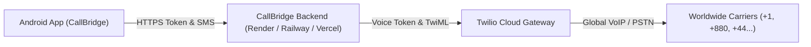

# 📘 CallBridge Self-Hosting & Deployment Guide

This guide provides step-by-step instructions for anyone to self-host and deploy **CallBridge** using their own Twilio account and free cloud hosting (Render, Railway, or Vercel).

---

## 🏗️ Architecture Overview

CallBridge consists of two components:
1. **CallBridge Android App:** The client UI with dialpad, 2-way SMS hub, local CRM, and real-time telemetry.
2. **CallBridge Cloud Gateway:** A lightweight Node.js/TypeScript server that signs short-lived Twilio Voice tokens, handles webhooks, and dispatches SMS.



---

## ⚡ Step 1: Prepare Your Twilio Account

1. Sign up at [Twilio.com](https://www.twilio.com/).
2. From the **Twilio Console Dashboard**, retrieve:
   - **Account SID** (e.g. `ACxxxxxxxxxxxxxxxxxxxxxxxxxxxxxxxx`)
   - **Auth Token** (e.g. `your_auth_token_here`)
3. Go to **Phone Numbers > Manage > Buy a number**:
   - Buy a virtual US (`+1`) or international phone number equipped with **Voice** and **SMS** capabilities.
4. Create an **API Key & Secret**:
   - Go to **Account > API Keys & Tokens > Create API Key**.
   - Save the **API Key SID** (`SKxxxxxxxx...`) and **API Secret**.
5. Create a **TwiML App**:
   - Go to **Voice > Manage > TwiML Apps > Create new TwiML App**.
   - Note the **TwiML App SID** (`APxxxxxxxx...`).
   - You will set its Voice Request URL after deploying your backend in Step 2.

---

## ☁️ Step 2: Deploy the Backend (Free Cloud Options)

### Option A: 1-Click Deploy on Render (Recommended)
1. Fork or push this repository to your GitHub account.
2. Go to [Render.com](https://render.com/) and create a **New Web Service** pointing to your forked repo.
3. Configure the service:
   - **Root Directory:** `backend`
   - **Build Command:** `npm install && npm run build`
   - **Start Command:** `npm start`
4. Under **Environment Variables**, add:
   ```env
   NODE_ENV=production
   PORT=10000
   TWILIO_ACCOUNT_SID=your_account_sid
   TWILIO_AUTH_TOKEN=your_auth_token
   TWILIO_API_KEY_SID=your_api_key_sid
   TWILIO_API_KEY_SECRET=your_api_key_secret
   TWILIO_TWIML_APP_SID=your_twiml_app_sid
   TWILIO_PHONE_NUMBER=your_purchased_phone_number
   PUBLIC_BASE_URL=https://your-service-name.onrender.com
   ```
5. Click **Deploy**. Render will generate a live URL like:  
   `https://callbridge-backend.onrender.com`

### Option B: Deploy on Railway
1. Go to [Railway.app](https://railway.app/).
2. Click **New Project > Deploy from GitHub repo**.
3. Point to the `backend/` folder and add the environment variables listed above.

---

## 🔗 Step 3: Connect Twilio Webhooks

Once your backend is live (e.g. `https://your-backend.onrender.com`):

1. **Voice Webhook:**
   - In Twilio Console, go to **Voice > TwiML Apps > [Your TwiML App]**.
   - Set **Voice Request URL** to:  
     `https://your-backend.onrender.com/api/v1/voice/outgoing` (HTTP POST)
   - Save changes.
2. **Incoming SMS Webhook:**
   - In Twilio Console, go to **Phone Numbers > Manage > Active Numbers > [Your Number]**.
   - Under **Messaging**, set "A MESSAGE COMES IN" Webhook to:  
     `https://your-backend.onrender.com/api/v1/sms/webhook` (HTTP POST)
   - Save changes.

---

## 📲 Step 4: Configure the Android App

1. Download and install **`CallBridge-v1.0.9-debug.apk`** on your Android smartphone.
2. Open **Settings** (bottom-right tab).
3. Under **Twilio Gateway Configuration**:
   - Tap **Backend Gateway URL**.
   - Paste your live cloud backend URL:  
     `https://your-backend.onrender.com`
   - Tap **Save & Test Connection**.
4. Set your **Caller ID**:
   - In Settings, set your active Twilio phone number (e.g. `+1 (202) 555-0199`).
5. Tap **Live Account Balance** refresh button:
   - Your real-time Twilio dollar balance will display on your Dashboard!

---

## 🎉 You're All Set!

- **Make Phone Calls:** Open the Dialpad, pick any country or type `+` with country code, and tap Call.
- **Send SMS:** Open Messages, compose a message with real-time 160-char segment counter, and text any mobile worldwide.
- **Privacy Guaranteed:** All your contacts and messages remain strictly on your Android device. Zero server logs or tracking.
